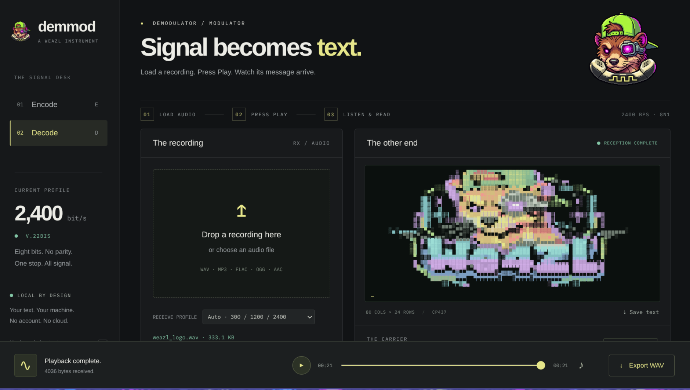

# Demmod

**Hear the signal. Recover the message.**

An experimental workbench for exploring and reverse-engineering audio modem signals. Encode text and ANSI art into actual modem audio, recover bytes from supported recordings, and watch messages arrive in an 80×24 color terminal as the sound plays.

If you remember dialing into a BBS, you remember waiting for the noise to become a connection—and for a screen to fill one character at a time. Demmod brings that experience to the browser, with the signal itself available to investigate. Every message is an opportunity to ask: how do bytes become sound, and what does it take to get them back?

The name reverses a modem's two jobs: **demodulate / modulate**.



*4,036 bytes recovered from a WAV into ANSI artwork. The picture is carried by the audio.*

## Why use it?

Demmod gives you both sides of an experiment: a way to generate a known signal and a way to recover data from a recording.

- **Investigate recorded modem traffic.** Try supported modulation profiles, listen to the recording, and export recovered bytes for further analysis. This can be a first step in reverse-engineering a legacy data exchange.
- **Generate reference signals.** Encode a known message at different rates and compare it with a recording you are studying. Choose either transmit channel and retain the WAV as a repeatable test input.
- **Test what survives an audio path.** Change the level, add noise, or compress a copy in an audio editor, then compare the recovered payload. Explore where acquisition fails or bytes become corrupted.
- **Teach digital communication through sound.** Make carrier tones, framing, character encoding and transmission speed tangible. At 300 bps with 8N1 framing, a continuous stream carries about 30 bytes per second; at 2400, about 240.
- **Build creative work with a recoverable message.** Put ANSI art or puzzle clues into audio that actually contains their data. The same signal can be listened to and decoded.

The longer-term goal is a bridge to physical modems and acoustic couplers. Today, Demmod provides software experiments and reference audio; hardware interoperability remains an open test gate.

## Run locally with Docker

Install Docker with the Compose plugin, download or clone this source, and open a terminal in the repository directory. Make sure port 5000 is available, then run:

```sh
docker compose up -d --build
```

Open **http://localhost:5000**. The first build downloads the build tools and audio dependencies. Go, Node, FFmpeg and SpanDSP do not need to be installed on the host.

Check the service or view logs:

```sh
docker compose ps
docker compose logs --tail=100 demmod
```

After pulling source changes, run the same build command to update the container. To stop it:

```sh
docker compose down
```

The container runs as a non-root user with a read-only filesystem and bounded temporary storage. Port 5000 is published to host loopback; use localhost or 127.0.0.1. LAN access and remote audio import are not configured. If the build cannot resolve package mirrors, check the Docker build environment's DNS.

## Your first experiment

1. In **Encode**, enter a short message or load the demo. Start with 300 bps and CP437.
2. Encode and export a WAV. Or enable **real-time transmission** to hear the samples as they are generated; the WAV becomes available when transmission finishes.
3. Switch to **Decode**, load the WAV, and press **Play**. The terminal reveals recovered characters against the playback clock. Save text exports the received byte prefix; seeking changes how much has been revealed.
4. Keep the original WAV and modify a copy in an audio editor. Try a lower volume, added noise, or a lossy export.
5. Load the modified recording and compare its recovered bytes with the baseline. A recording that sounds similar may yield different data—or no reliable signal.

For an exact comparison, compare exported payload bytes. Text editor line endings normalize to CRLF, so an original text file with LF endings may differ even before transmission.

## What works today

| Profile | Rate | Modulation | Status |
| --- | --- | --- | --- |
| Bell 103 | 300 bit/s | FSK | Software round trips and a real recorded message tested |
| V.22 | 1200 bit/s | DQPSK, 600 symbols/s | Experimental; software round trips tested |
| V.22bis | 2400 bit/s | 16-QAM, 600 symbols/s | Experimental; software round trips tested |

All profiles use **8N1**: eight data bits, no parity, one stop bit. Both answer and originate transmit channels are available. Receive mode supports automatic profile selection or an explicit rate.

- **Text:** CP437 or UTF-8; ANSI colors, basic cursor movement and erase operations. CP437 is recommended for the fixed 80×24 grid.
- **Audio input:** WAV, MP3, FLAC, OGG Vorbis/Opus, AAC and AAC in M4A. Format support does not guarantee that a recording contains a recoverable modem signal.
- **Audio output:** mono 8 kHz, 16-bit PCM WAV. Real-time transmission exports the same samples that were played. Stop cancels the transmission; interrupted streams cannot be exported.
- **Limits:** five minutes per recording, 50 MiB upload limit. Maximum encoded payloads are 8,964 / 35,460 / 70,920 bytes at 300 / 1200 / 2400 bps.

Software checks cover every byte value in both channels at all three rates. Bell 103 import tests cover the supported audio encodings. A real Information Society 300 bps recording has also been recovered. Higher-rate lossy-codec tolerance and physical modem compatibility are not established by those checks.

## Beyond text: binary files

A modem carries bytes. Text and ANSI art are ways to interpret those bytes; binary files are a natural extension of the same transport.

**Arbitrary binary-file transfer is planned, not implemented in the current interface.** A useful next step is a transfer envelope with a recognizable start marker, exact payload length and checksum, followed by binary upload/download and file metadata. This would let the receiver distinguish a file from startup noise or trailing carrier and report incomplete or corrupt transfers.

Integrity belongs to the payload:

```text
Original file → modem audio → recorded audio → recovered file
     │                                             │
     └────────── compare payload SHA-256 ───────────┘
```

The WAVs do not need to hash identically. Carrier duration, silence, gain, sample rate or individual sample values can change while the same payload remains recoverable. Matching file hashes would establish exact recovery for that test.

Legacy transfer protocols such as XMODEM or YMODEM are another possible extension. Their normal acknowledgment and retransmission behavior needs a return path; a fixed one-way recording cannot provide that conversation.

## Compatibility and scope

**Physical modem/acoustic-coupler interoperability is unverified at every rate.** At 1200/2400, the encoder trains against an internal simulated peer and records the selected transmitting direction. A fixed recording cannot adapt to a real modem's replies or timing. Bell 103 output includes a carrier lead-in. These are useful reference signals, with hardware acceptance still ahead.

Hardware experiments require matching modulation, the opposite receive channel, raw 8N1 and disabled error control/compression, configured according to the modem's manual. Prefer lossless WAV for playback.

There is currently no MNP, compression, 9600+ profile, telephone dialing sequence or live duplex modem interface. Demmod also does not yet provide a spectrogram, arbitrary modulation identification or higher-level protocol dissection. Its reverse-engineering scope is generating and recovering supported modem signals so their bytes can be examined further.

Raw 8N1 framing has no payload checksum. Automatic detection and plausible text are not proof of correctness. Noise, clock drift, lossy compression and missing startup can prevent acquisition or corrupt data. Compare against known payloads when possible.

## How it works

One Go service serves embedded vanilla HTML/CSS/JavaScript. FFmpeg converts imported recordings to mono 48 kHz PCM. A browser worker handles Bell 103 reception; a native C helper generates modem audio and uses dynamically linked SpanDSP for V.22/V.22bis transmission and reception.

Receive processing indexes the recording when it is loaded; playback controls when the recovered bytes become visible. Real-time transmit streams paced PCM from the native helper into Web Audio with a short jitter buffer. A stalled stream aborts rather than silently exporting incomplete audio.

All audio processing stays on the local machine. There are no accounts, cloud uploads, telemetry, remote fonts or runtime frontend dependencies. Temporary import files are deleted after conversion. Browser audio begins on user action at 20% volume.

## Native development setup

Docker is the simplest setup. To run directly on the host, install Go matching [go.mod](go.mod), a C compiler, FFmpeg, and SpanDSP development headers/libraries. SpanDSP's umbrella header also requires TIFF headers on some systems. The container currently builds against SpanDSP 0.0.6.

From the repository root:

```sh
mkdir -p bin
cc -O2 -Wall -Wextra native/modem.c -lspandsp -lm -o bin/demmod-modem
go run .
```

Open http://localhost:5000. Stop any container already using that port first. Native startup binds to 127.0.0.1:5000 by default; `GET /healthz` reports service health.

Run the Go and JavaScript/native tests with Go and a recent Node.js installed:

```sh
go test ./...
node --test tests/*.mjs
```

Build the helper first: native modem tests are skipped if it is absent. With the service running and FFmpeg installed on the host, test Bell 103 audio imports:

```sh
node scripts/smoke-formats.mjs
```

Optional browser acceptance requires Playwright and its Chromium browser:

```sh
node scripts/smoke-browser.mjs
```

Set `PLAYWRIGHT_MODULE` to the installed Playwright module path if it lives outside this project. The browser check exercises offline/live encode at all three rates, Play-driven receive, cancellation and browser errors. Node and Playwright are development tools only.

See [THIRD_PARTY.md](THIRD_PARTY.md) for native dependency details and [Sol's phased workbook](SOL_WORKBOOK.md) for implementation history, validation evidence and the remaining hardware acceptance work.
